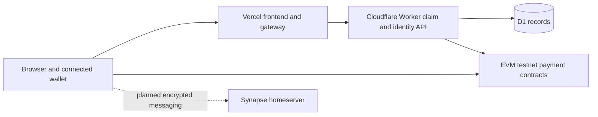

# Infrastructure plan for a small GhostPay pilot

This is a proposed deployment plan, not provisioned infrastructure. Choose one primary cloud for the initial messaging host; do not duplicate always-on infrastructure merely to spend two credit awards. AWS and Google application drafts describe alternative implementations. If both awards are granted, give each a distinct useful workload or defer unused capacity within its expiry period.

## Current architecture

The local Express relay stores requests in memory. It is for local development and must not replace the hosted durable relay as-is. Wallet signing stays with the connected wallet; neither cloud deployment needs a private key to approve or withdraw escrow payments.

## First credit-funded workload: messaging and backups

Use the existing [Matrix deployment bundle](../../infra/matrix/README.md), which needs a Linux host, Docker Compose, a domain, HTTPS and persistent storage. Long-lived Synapse is not hosted by a static frontend or a short-lived function. The bundle already keeps PostgreSQL/Synapse internal and exposes the intended routes through Caddy. Public registration stays disabled for an invitation-only pilot.

| Workload | AWS alternative | Google Cloud alternative | Implementation state |
| --- | --- | --- | --- |
| Synapse + PostgreSQL + Caddy | EC2 Linux VM | Compute Engine Linux VM | Compose bundle prepared; not deployed |
| Persistent data/media | EBS volume | Persistent Disk | Size, encryption and snapshot policy to configure |
| Encrypted backup objects | S3 | Cloud Storage | Backup/export/restore procedure to implement and exercise |
| Health/availability alerts | CloudWatch | Cloud Monitoring | Alerts and capped log retention to configure |
| Secrets and host access | IAM/instance role and protected host configuration | IAM/service account and protected host configuration | Owner accounts and least-privilege roles to configure |
| Domain and business email | Purchased domain + external mailbox | Purchased domain + external mailbox | Founder setup pending; credit coverage not assumed |

An initial sizing assumption is one modest VM with at least 2 GB RAM and limited persistent disk, subject to load testing. This is a planning assumption, not a verified capacity guarantee. Database and media growth, outbound traffic, backup requests and logs must be included in the estimate. Do not advertise high availability from this single-host pilot.

## Cost estimate worksheet

Use the [AWS Pricing Calculator](https://calculator.aws/) or [Google Cloud Pricing Calculator](https://cloud.google.com/products/calculator). Save the shareable estimate or a dated export privately. No monthly dollar estimate has been fabricated in this pack.

| Input | Record before provisioning |
| --- | --- |
| Region | Select after confirming pilot location and data requirements |
| VM SKU and architecture | Match tested container architecture; compare sustained monthly price |
| Run time | Up to 730 hours/month for an always-on service |
| Persistent disk | Starting GB, projected growth, disk type and snapshot storage |
| Backup storage | Encrypted DB/media exports, retention count, operation requests |
| Network | Internet egress, expected attachment sizes, federation traffic |
| Monitoring | Log ingestion, retention, metrics and alert costs |
| Other charges | DNS/static IP, support, taxes and excluded services if applicable |
| Budget | Founder-approved monthly cap and 50%/80%/100% alerts |

Budget alerts are notifications, not an automatic hard spending cap. Review credit expiration and eligible services in the awarded offer; billing continues for uncovered usage. At pilot end, export necessary records and deliberately stop unneeded resources while retaining recoverable backups.

## Deployment acceptance criteria

1. Owner-controlled DNS and HTTPS are valid; founder credentials and database ports are not public.
2. `node infra/matrix/check.mjs https://matrix.YOUR-DOMAIN` reports versions/CORS, login, discovery and blocked public admin routes. Replace the example hostname first.
3. Two real pilot accounts on separate devices exchange encrypted messages and verify device trust. Record encryption and recovery limitations honestly.
4. Backups include database, media, server signing key and necessary private configuration; restore succeeds in a separate environment. Do not publish any of those secrets in evidence.
5. Access controls, patch process, log retention and alert ownership are documented before inviting pilot users.

## Later backend migration

Before moving the claim/identity service to another provider, implement a durable store with the same uniqueness, signature-validation, deployment-isolation and optimistic concurrency guarantees. Test replay handling and concurrent approvals, define a maintenance window and export/import reconciliation, then cut over one canonical API. Existing signatures and immutable contract identities must remain usable. No D1-to-PostgreSQL migration is implemented or claimed in this release.
